# MakeMyTrip AI Trip Assistant

**An AI-native conversational trip-planning feature — from user research to a deployed prototype, bias-audited ranking logic, and a go-to-market plan.**

[]()
[]()
[]()
[]()

> **Live prototype:** [trip-assistant-2.ai.studio](https://trip-assistant-2.ai.studio/) · **Case study PDF:** [`case-study.pdf`](./case-study.pdf)

---

## The Problem

MakeMyTrip's recommendation engine kept surfacing the same popular, expensive, heavily-reviewed cities (Goa, Manali) regardless of what travellers actually typed — even an explicit offbeat request like *"Spiti Valley"* returned Manali resorts. This eroded trust and pushed travellers to plan manually via blogs and Reddit instead of using the app.

This project is an end-to-end product case study that researches the problem, designs and prototypes a fix, evaluates it against a golden dataset, audits it for bias and safety, and packages it with a pricing/GTM strategy.

## Approach at a Glance

```mermaid
flowchart LR
    A[User Research<br/>Personas + Empathy Maps] --> B[Opportunity Scoring<br/>RICE Framework]
    B --> C[PRD + User Stories<br/>INVEST-checked]
    C --> D[No-Code Prototype<br/>Auth + Persistence + LLM]
    D --> E[Eval Suite<br/>Golden Dataset + Rubric]
    E --> F[Responsible AI Pass<br/>Bias / Hallucination / PII]
    F --> G[Pricing + GTM<br/>Tiers, Positioning, Revenue]
    G --> H[Growth Loop +<br/>Funnel Diagnostics]
```



## What's Inside

| Section | Summary |
|---|---|
| [**01 · Research & PRD**](./docs/01-research-and-prd.md) | Two evidence-based personas, competitive teardown, RICE-scored feature backlog, and a full PRD-lite with INVEST-checked user stories, North Star/guardrail metrics, and edge cases. |
| [**02 · Prototype, Build & Evals**](./docs/02-prototype-and-evals.md) | Working no-code app (auth + persistence + catalogue-constrained LLM generation), an automated human-review pipeline, and an 8-input golden-dataset eval suite. |
| [**03 · Pricing & GTM**](./docs/03-pricing-and-gtm.md) | Good-Better-Best pricing with decoy-tier and anchoring tactics, full GTM framework, value proposition canvas, and a bottom-up Year-1 revenue model. |
| [**04 · Growth & Responsible AI**](./docs/04-growth-and-responsible-ai.md) | Funnel drop-off diagnostic, an AI-driven growth loop, product lifecycle mapping, and a Govern/Map/Measure/Manage post-launch monitoring plan. |

## Key Outcomes

- **Selected feature:** Conversational Trip Assistant with clarifying follow-up questions and explainable recommendations — highest RICE score (3,200) of four scored candidates.
- **Eval results:** 35/40 assertion checks passed across an 8-input golden dataset; gaps traced to catalogue coverage for two international destinations and logged as a follow-up.
- **Bias mitigations shipped:** four targeted, independently testable mechanisms — popularity rotation cap, pre-LLM budget filter, geographic-cluster diversity requirement, and relevance-weighted ranking (de-weighting raw review count).
- **Funnel insight:** the real bottleneck isn't top-of-funnel awareness (30,000 users lost at banner → open) — it's a **70% drop-off between itinerary viewed and booking/save**, the exact trust gap this feature was built to close.
- **Revenue model:** ≈ ₹1.08 crore projected Year-1 revenue at 100K MAU and 4% paid conversion.

## Methodology & Frameworks Used

`Proto-personas` · `Empathy Mapping` · `AEIOU` · `RICE Prioritization` · `PRD-Lite` · `INVEST` · `North Star + Guardrail Metrics` · `AI Feature Ladder` · `4D Framework` · `Golden-Dataset Evals` · `Responsible AI (Govern / Map / Measure / Manage)` · `Good-Better-Best Pricing` · `Value Proposition Canvas` · `AI Product Loops`

## Responsible AI

Every AI-generated explanation passes through a **human-review checkpoint** before it ever reaches a user — a deliberate, non-automated gate because showing an unreviewed AI explanation directly to a customer is a hard-to-reverse action. Full design details, including prompt-injection handling, hallucination controls, and four named bias mitigations, are in [Part 2](./docs/02-prototype-and-evals.md#5-responsible-ai-design-pass) and the [post-launch monitoring plan](./docs/04-growth-and-responsible-ai.md#5-post-launch-responsible-ai-monitoring-plan).

## Repository Structure

```
.
├── README.md                              # You are here
├── case-study.pdf                         # Full case study, exported
└── docs/
    ├── 01-research-and-prd.md             # Personas, teardown, RICE, PRD-lite
    ├── 02-prototype-and-evals.md          # Build, automation, evals, responsible AI
    ├── 03-pricing-and-gtm.md              # Pricing, GTM, VPC, revenue model
    └── 04-growth-and-responsible-ai.md    # Funnel, growth loop, monitoring plan
```

## Author

**Pravin Chaturvedi** — Product Manager
[GitHub](https://github.com/pkchat55)

---

*This repository documents a product case study: problem framing, prototype, evaluation, and go-to-market design for an AI-native travel-planning feature.*
